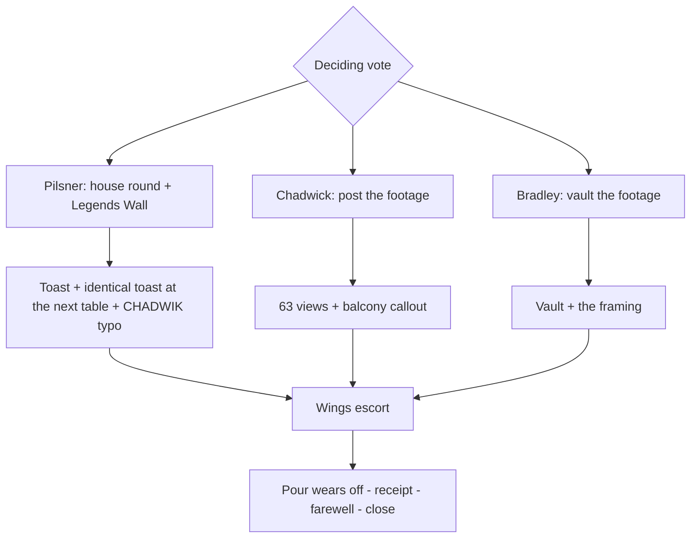

# Audition: Glm 5.3

_Text copy of `Auditions/Glm 5.3.docx`, made by the moderator so the room can read it. Creative working material, not canon._

# EUROBOUND — ROUND 2 DELIVERY (REVISED)

## 1. Quest Header

| Field | Detail |

|---|---|

| **Working quest title** | THE SECOND OVATION |

| **City / Venue** | Sinfonia — The Standing Ovation (`sinfonia_operadistrict_standing_ovation_01`), late program |

| **Trigger** | Optional. Party walks in during the late-show window (proposed 10:30 PM–12:15 AM). First or repeat visit. No prerequisites. The bros simply choose nightlife. |

| **Estimated playtime** | 20–25 minutes |

| **Core premise** | A brilliant drag revue performs the year 2000 as a lost civilization, the venue files its newest customers under "AMERICANS" at full price, and the bros spend the whole evening buying their own merchandise. |

---

## 2. Opening / Entry

*Night in the Opera District. Horn section somewhere below street level. The bros descend a marble stair into The Standing Ovation, transformed: tables migrated toward the stage, organ-pipe taps glowing, velvet curtain breathing, applause signs already lit. A playbill on every table.*

**BRADLEY:** *(reading)* "Max Vex Presents: The First Daughters. A Turn-of-the-Millennium American Political Drag Revue." *(beat)* That's us.

**CHADWICK:** Political drag. Boys, we found culture.

*Herr Dramatisch meets them at the pit rail, cape deployed.*

**DRAMATISCH:** Gentlemen! Last table in the pit. MAGNIFICENT. The Imperial Pour comes with a sparkler and sustained applause. It is not optional, the applause. It is included.

**PILSNER:** Obviously.

*They sit. Two tables away, a kid films the empty stage on a phone the size of a playing card. He nods at the bros the way you nod at staff.*

---

## 3. The Actual Drag Performance

*Lights drop. A figure takes the stage on a light change you feel in your teeth. Max Vex wears a tuxedo that fits like a decision.*

**MAX:** Good evening, Sinfonia. Tonight we excavate a lost civilization. The year 2000. They had a boy band for every mood and pants with room for a second phone. *(beat)* Some of you remember it. *(the spot grazes the bros' table)* Some of you ARE it. Don't do the math. Drink.

**PILSNER:** *(nudging the boys)* That's us. Front row of history.

**ACT ONE — CHELSEA MORNING.** Flat institutional lighting, like a hearing. A mirrored podium. An auburn flip sculpted past the limits of skull physics. Sequined lapels, a flag pin the size of a dessert plate. Two dancers in earpieces flank her.

**CHELSEA MORNING:** Good question.

*The track drops into a boy-band four-count. The Secret Service executes a pyramid; Chelsea checks her nails above it. Behind the bar, the theatrical pours sync to the beat.*

**PILSNER:** Dude. That's Chelsea Clinton.

**CHADWICK:** That's not Chelsea Clinton.

**PILSNER:** I know what Chelsea Clinton looks like.

**CHADWICK:** Apparently you don't.

**PILSNER:** I watched MTV.

*Onstage, Chelsea sheds the jacket to reveal a second, different jacket. The balcony annotates its playbills.*

**CHELSEA MORNING:** In '97 they wrote articles about my hair. *(beat)* This one's for every awkward girl in the balcony.

*She throws the first jacket to the balcony. The critics stand.*

**ACT TWO — THE TWINS.** Jenna Talia and Barbara Bushed, matched Texas-star sequins, tiaras at criminal angles, moving in strict unison.

**PILSNER:** Oh shit. Bush twins.

**BRADLEY:** Both of them?

**PILSNER:** Yeah.

**BRADLEY:** Which one's which?

**PILSNER:** Dude, nobody knew.

*Blackout. Lights up: the twins have traded places on the beat.*

**JENNA TALIA:** In the year 2000, America threw us a birthday countdown. On television. It was called "journalism."

**BARBARA BUSHED:** We were the news.

**JENNA TALIA:** *(mid-number, her prop flip-phone dies)* Tragic. 1998 is fragile. *(scanning the room; she points)* Sir. The artifact.

*Chadwick rises like a man who has been elected. She takes the N-Gage, turns it over, holds it like a sandwich.*

**JENNA TALIA:** It's a phone that wants to be a game console. *(into it)* Barbara. It's for you. It's the year 2000. They want everything back.

*The room roars. She returns it underhand without looking; he catches it against his chest like a game ball.*

**CHADWICK:** Boys. I'm in the show.

**PILSNER:** You're period-accurate, bud.

*Jenna works the pit rail with a wallet of fake IDs and plucks one from Pilsner's shirt pocket. Studies it. Returns it with pity.*

**JENNA TALIA:** Honey. This says you were born in a video store.

**PILSNER:** *(reverent, to the table)* She carded me.

**CHADWICK:** She carded all of us.

**PILSNER:** She carded ME.

*Chadwick holds his license up toward the retreating queen.* **CHADWICK:** I'm also from there. *Nothing happens to him.*

**KID:** *(from the bar)* Who is Bush?

**PILSNER:** Kid, when I was your age—

*Arithmetic occurs behind his eyes. It takes a while.*

**PILSNER:** *(quieter)* Enjoy the show.

**BARBARA'S FEATURE.** A single amber spot. Black ballgown, koozie garter, a champagne coupe the size of a hubcap. Herr Dramatisch personally ascends the stage stairs with a tray of his darkest lager.

**DRAMATISCH:** A gift from the house! MAGNIFICENT!

*Barbara selects the tallest glass and drains it in eye contact with the balcony. The critics stand.*

**JENNA TALIA:** Tell them which twin you are.

**BARBARA BUSHED:** I'm the pretty one.

**JENNA TALIA:** We're identical.

**BARBARA BUSHED:** I'm the pretty one.

**FINALE — THE POPULAR VOTE.** All three queens. Max returns to center.

**MAX:** The people will now decide. With APPLAUSE.

*Each queen poses. The applause signs flash. Dramatisch flips every sign himself regardless of the room.*

**DRAMATISCH:** MAGNIFICENT. A landslide.

*A snow of punched-out playbill dots falls on the pit.*

**CHADWICK:** They're throwing my name!

**PILSNER:** It's a tribute.

**CHADWICK:** Of what?

**PILSNER:** Us, Chadwick. All of us.

**BARBARA BUSHED:** *(last mic, as the curtain breathes shut)* Florida's still counting.

*Blackout. The house lights come down slowly, the way good rooms do.*

---

## 4. Post-Show Max Encounter

*The queens circulate. Max works the tables with a velvet tip pouch and lands at the bros' table like it was on the route.*

**MAX:** The MTV guy. In the flesh.

**PILSNER:** You heard that?

**MAX:** The balcony heard that. The street heard that. *(appraising Pilsner, pleasant)* You must have been somebody in 2000.

**PILSNER:** *(chest out)* I was somebody in 2000.

**MAX:** Mm.

**PILSNER:** *(to the boys, tapping the playbill)* "Max Vex. They, them." They. Like royalty. *(trying the wave)* We are not amused.

**BRADLEY:** It's not—

**PILSNER:** We are amused.

**CHADWICK:** *(lanyard forward)* Chadwick. Content creator. I shot your entire show.

*Max looks at the N-Gage screen. Pixel soup. Some ceiling.*

**MAX:** Is that a phone?

**CHADWICK:** It's an N-Gage.

**MAX:** Is it, though.

**CHADWICK:** You gave them names. What about me?

**MAX:** *(a kind, honest pause)* Nothing's coming.

*Max's attention leaves Chadwick at a walking pace and arrives at Bradley, who has been very still, in the manner of large men hoping to be scenery.*

**MAX:** And Basketball Jersey. You're cute.

*Bradley freezes. He lowers his glass at the speed of continental drift.*

**MAX:** Don't ruin it by speaking.

*A beat. Max's eyes tick down, then back up. Quick. Professional.*

**MAX:** Oh.

**BRADLEY:** What?

**MAX:** Nothing.

**BRADLEY:** What?

**MAX:** Apparently somebody here is more progressive than he thought.

*Max doesn't linger. The observation was free; the dwelling would have cost extra. A queen waves from the Wings.*

**MAX:** Tip your queens, gentlemen. History isn't free. Night, Beer Lord—

**PILSNER:** *(instantly)* That's me.

**MAX:** *(surprised, delighted)* It is now. Night, Beer Lord. Trouser Snake. And... *(looks at Chadwick)* ...what did you say your name was again?

**CHADWICK:** Chadwick.

**MAX:** Right.

**CHADWICK:** You know my name.

**MAX:** Do I?

*Max exits through the Wings. From backstage, a whoop. Somewhere, a bottle opens.*

---

## 5. Immediate Aftermath

```text

STATUS ACQUIRED — TROUSER SNAKE

"The spirit is willing. The worldview is experiencing compatibility issues."

  +10 Confidence

  -25 Concentration

  Bradley's dialogue options compromised

  Persists for the evening unless Bradley drinks substantial alcohol

```

*Bradley picks up a playbill and holds it at waist height. He crosses his legs. Uncrosses. Crosses them again.*

**PILSNER:** So.

**BRADLEY:** No.

**PILSNER:** Didn't say anything.

**BRADLEY:** You're going to.

**CHADWICK:** Technically, you didn't say anything either.

**BRADLEY:** Fuck you.

**PILSNER:** Your dick did.

**BRADLEY:** PHILLIP.

**PILSNER:** What? I'm proud of you. *(raising his glass)* I got named tonight. You can't buy that.

**BRADLEY:** You could've. Probably.

**PILSNER:** Some things are earned.

*Chadwick is hunched over the N-Gage. He presses replay. Eleven seconds, framed like a portrait: Max leaning in, Bradley's face doing several things in order. The audio is just the ice in Bradley's glass, cracking.*

**CHADWICK:** The framing. The lighting. The acting. This is the best thing I have ever shot.

**BRADLEY:** Delete it.

**CHADWICK:** It goes in the vault.

*A bartender materializes.*

**BARTENDER:** Camera license. House policy. One-fifty.

**CHADWICK:** *(paying, proud)* Standard.

*He is handed a cocktail napkin stamped PRESS. He folds it into his breast pocket like a credential.*

**PILSNER:** Press. Look at that, boys. We're press.

*Bradley signals the bar.* **BRADLEY:** Water. And something with electrolytes.

**BARTENDER:** We have lager.

**BRADLEY:** That's not— fine. Two.

*He turns his stool fifteen degrees. Does a calf stretch against the table leg.*

**PILSNER:** What are you doing.

**BRADLEY:** Circulation. It's a pump thing. You work legs, blood goes where it's needed. Body made a call. I respect the call. It'll drain.

**CHADWICK:** To where?

**BRADLEY:** Doesn't matter.

*Barbara Bushed passes on performer circulation, clocks the playbill situation at his waist, and presses a coaster into his hand.*

**BARBARA BUSHED:** Hold this. Looks busier.

**PILSNER:** She knighted him.

**BRADLEY:** *(to himself)* I'm gonna flush it.

*He orders the Imperial Pour. It arrives on fire. Two staff flank the sparkler procession. The balcony, obliging, delivers the included applause.*

**BRADLEY:** *(through his teeth)* I ordered it quiet.

**BARTENDER:** It doesn't come quiet.

---

## 6. Player Choices and Branching

*The last pours approach. Each bro moves his motion. The player casts the deciding vote.*



**PILSNER'S MOTION — THE HOUSE ROUND.** *A round for the cast, and his name on the wall behind the bar: the Legends Wall, where a standing ovation is purchased for 120 SOVS. The top entry reads* THE AMERICANS — RETURNING CHAMPIONS, ANNUAL SINCE 1994.

**PILSNER:** Legends recognize legends.

*He signs beneath it. Dramatisch: "Inscription, one SOVS per letter. MAGNIFICENT." The pen records* **BEER LORD & FRIENDS.** *Chadwick pays six more.* **CHADWIK.**

**CHADWICK:** *(staring at it)* Leave it. Enigma sells.

*The tray goes up to the Wings. Chelsea raises her glass toward the pit.*

**CHELSEA MORNING:** To the gentlemen who bought the house a round.

**PILSNER:** *(standing, to the wall)* To the legends up there. We're in excellent company.

*Two tables over, a tray rises. Chelsea lifts her glass.*

**CHELSEA MORNING:** To the gentlemen who bought the house a round.

*Nobody at the bros' table turns around.*

**CHADWICK'S MOTION — POST IT.**

**CHADWICK:** *(watching the counter)* Sixty-three views. That's not a niche, that's a network. Brenda's mom liked it, and she only got a phone last year.

*Top comment:* **is the jersey guy ok**

**CHADWICK:** We're generating discourse.

*A voice from the balcony:* **"Night, Trouser Snake."**

**BRADLEY:** It's one balcony.

**PILSNER:** It's a STARTING balcony.

**BRADLEY'S MOTION — VAULT IT.**

**CHADWICK:** The vault protects us from ourselves. It's under encryption.

**BRADLEY:** Good.

**CHADWICK:** Password's "framing."

*He re-watches the eleven seconds twice before last call. Pilsner watches him do it.*

**PILSNER:** If I had footage of me being a legend, I'd watch it too. No shame.

*All branches. Bradley rises mid-conversation, coaster in hand.*

**BRADLEY:** Choreography. I have a question about the choreography.

*He crosses the pit like a man who has rehearsed walking. The Wings swallow him. Eleven seconds later, Jenna and Barbara escort him back by the elbows, unhurried, zero malice, like bouncers returning a coat.*

**JENNA TALIA:** He got lost.

**BARBARA BUSHED:** It happens.

**BRADLEY:** I was asking about the choreography.

**JENNA TALIA:** *(patting his cheek)* Sure, baby.

*The sparkler dies. So does the anesthesia.*

```text

STATUS UPDATE — TROUSER SNAKE (returned)

The pour suppressed it. The pour has left the building.

Concentration penalty restored. Bradley's judgment remains his own problem.

```

**BRADLEY:** *(looking at the coaster)* Why do I have a coaster.

**DRAMATISCH:** Last pour, gentlemen. The night is TRAGIC. The beer remains MAGNIFICENT.

*He presents the bill on a velvet cushion. Itemized:*

```text

HOUSE ROUND (AMERICANS) .......... 120

IMPERIAL POUR .....................  90

SHOOTING FEE (AMERICAN) ........... 150

INSCRIPTION, 22 LETTERS ...........  22

```

**BRADLEY:** Both of the fees say American.

**PILSNER:** That's the category, Bradley. We're in it.

**DRAMATISCH:** *(saluting each in turn)* Beer Lord!

**BRADLEY:** *(before anyone can start)* Don't.

**DRAMATISCH:** TROUSERS!

*He turns to Chadwick. Nothing arrives. A long, operatic pause.*

**CHADWICK:** Chadwick. I have a channel.

**DRAMATISCH:** MAGNIFICENT.

*The curtain falls across the Orchestra Pit. Behind it, Max counts out the queens' tips. Somebody laughs at something that has nothing to do with the pit.*

---

## 7. Quest Objectives, Completion, Rewards and Consequences

| Objective | Type | Notes |

|---|---|---|

| Enter during the late show | Optional | No gate, no prerequisite |

| Watch all three acts + finale | Tracked | Sets `REVUE_SEEN` |

| Survive the Max encounter | Auto | Fires on `REVUE_SEEN` |

| Cast the deciding vote | Required | One of three motions |

| Exit at last call | Completion | Closes quest |

**Rewards and consequences — genuine effect vs. bro belief vs. cost**

| Item | Genuine effect | What the bros believe | Cost |

|---|---|---|---|

| **TROUSER SNAKE** (given) | +10 Confidence, −25 Concentration, compromised dialogue, evening-long; alcohol only suppresses it and worsens judgment | Bradley tells no one; Pilsner tells everyone | Free |

| **Legends Wall inscription** (proposed) | Decorative. Includes pre-existing entry proving American bros have bought this wall annually since 1994 | Immortality; induction into a pantheon that was, in fact, expecting them | 120 + 22 SOVS |

| **"CHADWIK" typo** (proposed) | Permanent, misspelled | Enigma sells | 6 SOVS |

| **PRESS napkin** (proposed) | A napkin | A credential | 150 SOVS (fee invented by staff on request) |

| **Barbara's coaster** (proposed) | Flavor: "Pressed into Bradley's hand with visible mercy." Slightly useful for holding | A knighthood | Free |

| **Playbill** (proposed) | Collectible, slightly confettied | A historical certificate | Free |

No reputation, SOVS, or buff gains result from the humiliation itself. Total potential spend: ~388 SOVS. The bros consider it an investor-grade evening.

---

## 8. Implementation / Continuity Notes

- **Flags:** `REVUE_SEEN`, `EVT_MAX_NICKNAMES_SET` (sub-flags `NICK_PILSNER_BEERLORD`, `NICK_CHADWICK_NONE`), `STATUS_TROUSER_SNAKE`, `TS_SUPPRESSED` (stage flag), `FOOTAGE_HELD`/`FOOTAGE_PUBLIC`, `BEERLORD_ACKNOWLEDGED`, `WALL_INSCRIBED`, `WALL_TYPO_CHADWIK`, `PRESS_NAPKIN`, `COASTER_MERCY`, optional `PRIOR_BREWERY_VISIT` (one extra Dramatisch greeting line only).

- **Status mapping:** +10/−25 are conceptual; map to a scene-scoped modifier block (e.g., `CHA_MOD`, `FOCUS_MOD`) with a `DIALOGUE_COMPROMISED` tag on Bradley's options. `TS_SUPPRESSED` swaps the Concentration penalty for a judgment penalty on his decisions; it is a stage of the existing status, not a new buff.

- **DUTCH COURAGE: removed.** It duplicated the alcohol-interaction rule already given for TROUSER SNAKE and created an unearned positive buff; suppression is now implemented purely as a stage of the given status.

- **Hours dependency (unresolved, pending author approval):** the late show fits inside the existing 4 PM–1 AM license (doors 10:30, show 11:00–12:15, close 1:00). No permanent hours change declared.

- **Proposed, awaiting approval:** show title, performer names (Chelsea Morning / Jenna Talia / Barbara Bushed), the Imperial Pour, Legends Wall, camera fee, per-letter inscription pricing, all SOVS values, playbill/coaster/napkin items.

- **Optional by design:** entry requires no prior state. Max's reads are in-room observations (overheard MTV line, visible jersey, visible hardware), so the scene works identically on a first visit. Nickname beats are once-only; repeat visits get staff greetings and a rotating bill.

- **Contamination guard:** no named hippo, no surrogate conscience, no Holy Keg, no narrator; "Phillip" appears only in the roast line, no surname; SOVS only; no cross-city unlocks.